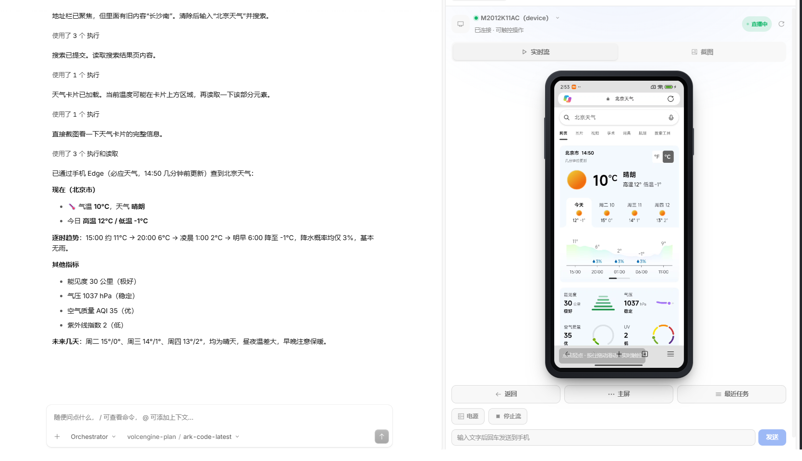

# opencode-mobile-mirror

**English · [简体中文](README.zh-CN.md)**

An [OpenCode Desktop](https://opencode.ai) GUI plugin that mirrors a connected Android phone inside the side panel and lets you control it with the mouse — tap, swipe, type, and press hardware keys. It works over local `adb`, requires no root and no emulator.



## Highlights

- **Real-time video stream (~30 fps)** powered by [scrcpy](https://github.com/Genymobile/scrcpy) via the [Tango](https://github.com/yume-chan/ya-webadb) TypeScript stack, decoded in-process with WebCodecs and rendered to a WebGL canvas.
- **Screenshot fallback mode** — a lightweight 2-second polling path for environments without WebCodecs.
- **Interactive control** — the cursor is a hand pointer; click to tap, drag to swipe, type text, and send Home / Back / Recents / Power. Pointer capture guarantees the virtual finger always lifts, even if the mouse leaves the frame.
- **Rotation aware** — the phone body switches between portrait and landscape form factors as the device rotates.
- **Chinese input support** — non-ASCII text is delivered through the device clipboard with auto-paste.
- **Single-file plugin** — everything is bundled into one CommonJS module; the scrcpy server is embedded as base64, so no extra binaries ship alongside.

## How it works

```
OpenCode panel (SolidJS + WebCodecs canvas)
        │  typed IPC bridge (events + methods)
        ▼
Electron main process  ── adb (127.0.0.1:5037) ──► Android device
        └─ Tango scrcpy client: push server, start H.264 stream, inject touch/key
```

- The **main process** is the only place allowed to spawn native binaries and run the Tango scrcpy client. It locates `adb` on its own (including the common Scoop/Android SDK paths), so GUI apps that miss the shell `PATH` still work.
- Encoded H.264 packets travel back to the window over an IPC **event** channel as raw `Uint8Array`; the **window** decodes and renders them.
- Touch coordinates are mapped from the displayed (object-fit: contain) canvas back to physical video pixels, so taps stay accurate in any size or orientation.

## Requirements

- OpenCode Desktop (the plugin uses the experimental GUI extension API).
- Android Platform Tools (`adb`) installed and the device connected with **USB debugging** enabled (or `adb connect` over Wi-Fi).
- A Chromium-based runtime with WebCodecs (bundled in OpenCode Desktop) for the real-time stream.

## Install

This is a local plugin. Build it and register the folder in your OpenCode config:

```bash
npm install
npm run build
```

Then reference the local directory in `opencode.json` (the exact field depends on your OpenCode version):

```json
{
  "plugins": ["E:/path/to/opencode-mobile-mirror"]
}
```

Open a session, open the **+** menu in the side panel, and choose **Phone mirror**.

## Usage

- The device name in the header is itself a dropdown — use it to switch between multiple connected devices.
- Toggle **Live stream** (scrcpy, ~30 fps) or **Screenshot** (2s polling) with the segmented control.
- In live mode, hover the screen to see interaction hints; tap, drag, and use the Home / Back / Recents / Power buttons below.
- Type into the input box and press Enter. ASCII is injected directly; Chinese and other IME text is pasted through the clipboard automatically.
- Rotate the phone (e.g. full-screen video) and the panel body rotates with it.

## Project structure

```
src/
├── contract.ts          IPC contract (effect Schema): methods + videoPacket/streamStatus events
├── main.ts              Electron main: adb bridge, screenshots, scrcpy session lifecycle
├── scrcpy-session.ts    Tango scrcpy wrapper: push server, stream packets, touch/key/text injection
├── stream-controller.ts Window side: subscribe to packets, WebCodecs decode, canvas render, coord mapping
├── scrcpy-server.ts     Embedded scrcpy v3.3.3 server as base64 (generated, do not edit)
├── view.tsx             SolidJS panel: phone frame, mode switch, controls, pointer handling
├── gui.tsx              Plugin entry: registers the Side Panel / Command / MenuItem
├── mirror.css           mm- prefixed styles mapped to the host theme variables
└── vendor/              Source scrcpy server binary
vite.config.ts          Bundles to a single CommonJS file; stubs the WASM fallback decoder
```

## Development

```bash
npm run build       # produce dist/gui-experimental.cjs (single file)
npm run watch       # rebuild on change
npm run typecheck   # tsc --noEmit
```

The host app hot-reloads the GUI bundle on rebuild. When you change the IPC contract (methods or events), restart OpenCode Desktop fully so the main and window processes load the same schema.

## Troubleshooting

- **Stuck on "starting live stream"** — check the desktop logs (`%APPDATA%/ai.opencode.desktop/logs`). A `plugin event encoding failed` entry usually means a required field was missing; all Struct payloads must include every declared key (`null` is allowed, an absent field is not).
- **Panel shows no device** — confirm `adb devices` lists the phone and that USB debugging is authorized.
- **Stream works but screenshot mode looks letterboxed in landscape** — expected; `screencap` keeps the portrait canvas. Switch to live stream, which re-encodes to a true landscape frame.
- **Chinese text does not appear** — tap an input field on the phone first so it has focus; the plugin pastes via clipboard.

## Limitations

- Android only (iOS would need a cloud-device path, as local control is not supported on Windows).
- Screenshot mode polls every 2s and cannot natively rotate the frame; live stream is the recommended mode for video and fast interaction.
- The embedded scrcpy server is Apache-2.0 licensed; see the upstream scrcpy project.

## License

MIT


